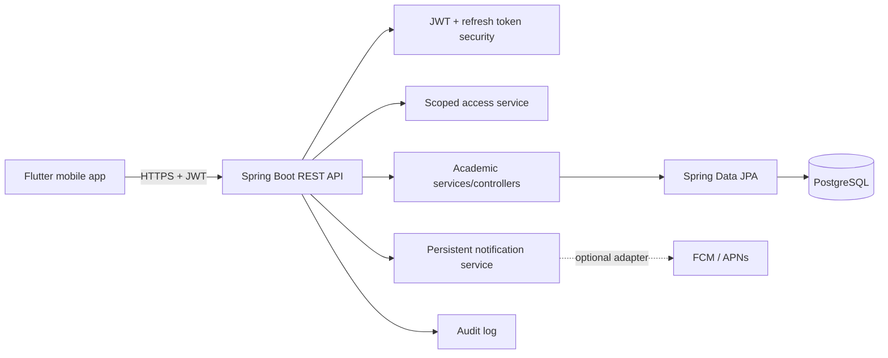

# Architecture

## Authorization model

Authorization is resource-scoped, not just a list of global roles.

- HOD assignment points to a department.
- Class-teacher assignment points to a classroom.
- Subject-teacher assignment points to a class-subject.
- Student access comes from an active classroom enrollment.

This prevents a teacher assigned to `FY-A / WEB` from modifying `SY-A / DBMS` even though both belong to the same account and department.

## Context model

`GET /api/v1/me/contexts` returns all active responsibilities. The Flutter client maintains an active classroom selection and filters classroom-specific work to that context. This solves the common problem where a teacher teaching several years sees an unusable mixed feed.

## Backend modules

- `security` — JWT parsing and stateless authentication.
- `domain` — JPA entities and enums.
- `repository` — Spring Data persistence.
- `service` — access control, authentication, contexts, notifications and audit support.
- `api` — REST DTOs/controllers and error handling.
- `config` — security/OpenAPI/dev seed.

## Data integrity

Flyway owns the schema. Unique constraints protect key relationships such as enrollment, class-subject links, submission-per-student and attendance-record-per-session.
