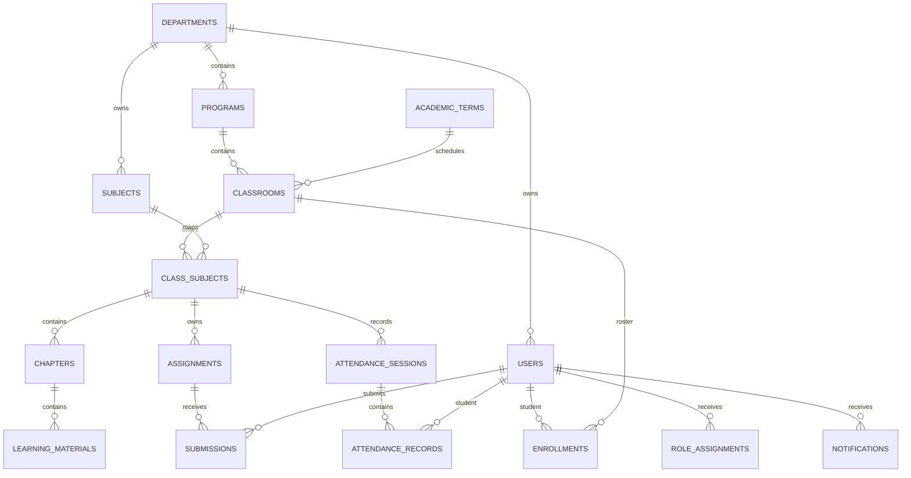

# Database design

The executable schema is `backend/src/main/resources/db/migration/V1__initial_schema.sql`.

## Important constraints

- Department code is unique.
- Program code is unique inside a department.
- Subject code is unique inside a department.
- One subject may be linked only once to a classroom.
- One student has at most one enrollment row per classroom.
- One student has at most one submission per assignment.
- One attendance record exists per student/session.

Role assignments are soft-deactivated with `active=false` so historical relationships do not need destructive deletion.

## Additive lifecycle migration

V3 adds assignments.closed_at and submission_revisions with a submission foreign key and a submission/time index. Clean migration and V1-to-V3 upgrade tests pass against PostgreSQL 18. Existing submissions remain in place; earlier versions are recorded only when a new revision is submitted. The task's isolated validation cluster is stopped after checks.

## V4 — stored files

`stored_files` records owner, chapter OR assignment, unique server-generated storage key, sanitized filename, verified MIME type and byte size. PostgreSQL requires exactly one scope and sizes from 1 through 10485760 bytes. The actual bytes live in the configured private storage directory, not PostgreSQL. Historical submission URLs remain intact; older external URLs are unchanged. Back up both database and storage.
